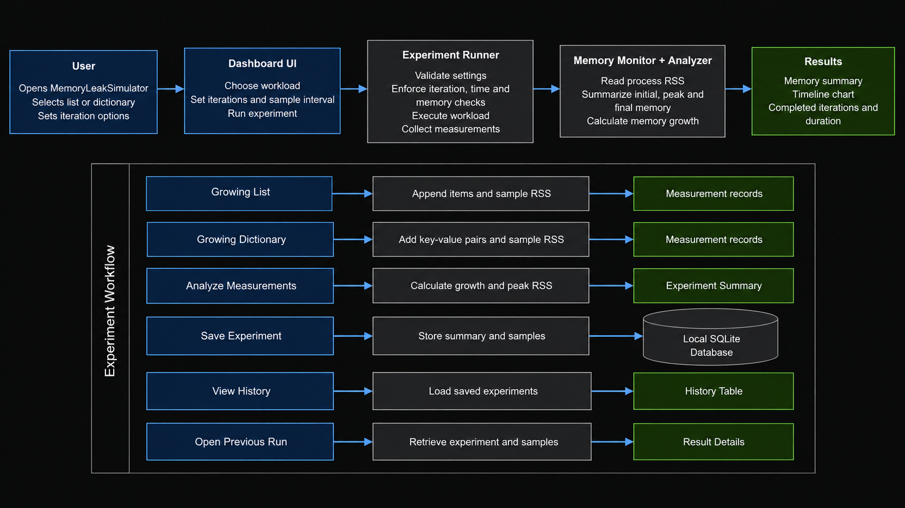
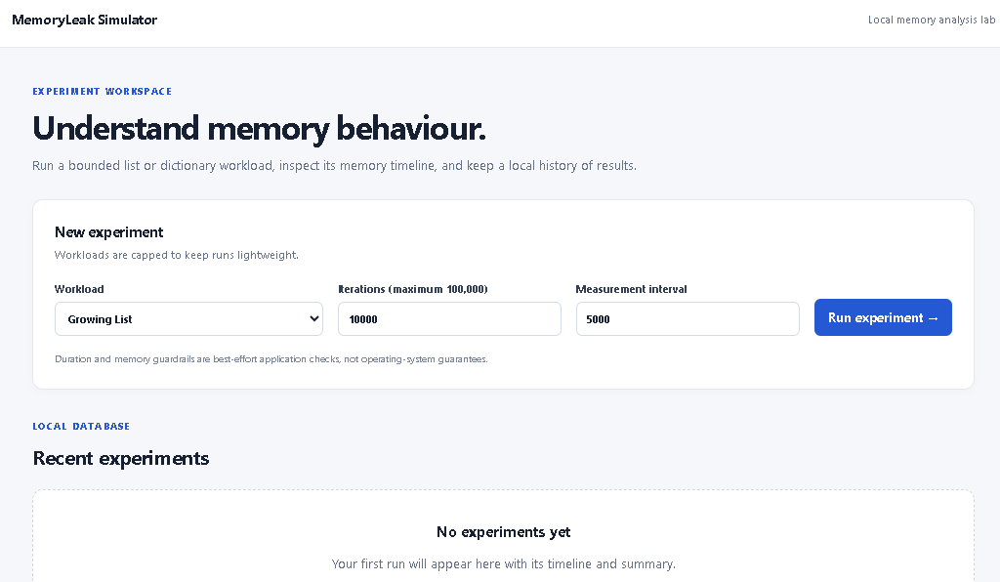
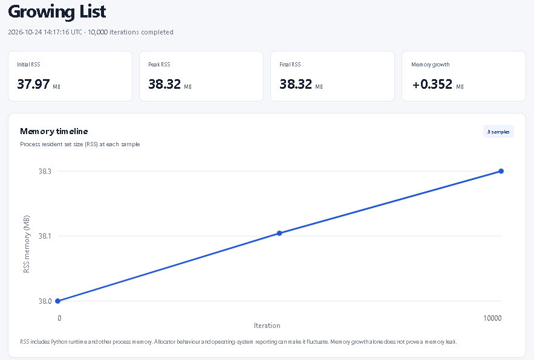
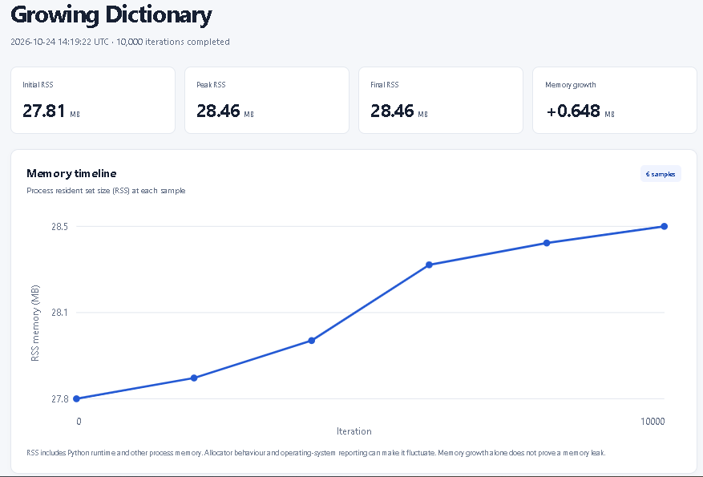
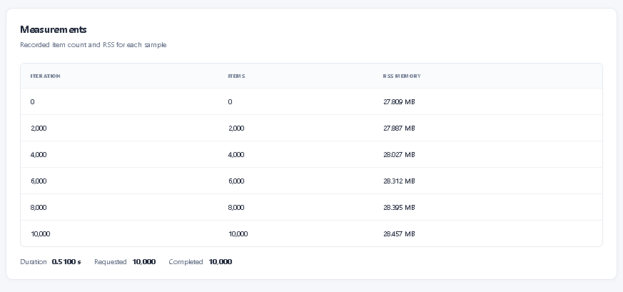
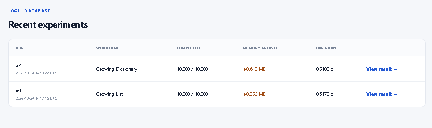

# MemoryLeak Simulator

**Python Memory Analysis Laboratory**

MemoryLeak Simulator is a lightweight, local web application for exploring Python memory behaviour through controlled workloads. It measures process memory, summarizes memory changes, visualizes experiment timelines, and stores experiment history in SQLite.

## Features

- **Controlled workloads:** Grow a Python list or dictionary incrementally.
- **Memory monitoring:** Measure process resident set size (RSS) using `psutil`.
- **Memory analysis:** Calculate initial, peak, and final memory usage, plus memory growth.
- **Timeline visualization:** View memory measurements in a chart.
- **Experiment history:** Save and revisit results using SQLite.
- **Resource guardrails:** Configure iteration, duration, and memory limits.
- **Automated tests:** Validate the core functionality and web application.
- **Responsive interface:** Use the dashboard on desktop or mobile screens.

## Workflow Architecture

The diagram illustrates how MemoryLeakSimulator runs bounded memory experiments, records RSS measurements, analyzes memory growth, and stores results in a local SQLite database for later review.



## Screenshots

### 1. Application Overview

The main dashboard allows users to configure and run bounded memory experiments using growing lists and dictionaries. It also displays recent experiment history.



### 2. Growing List Experiment

Displays the memory usage summary and timeline for a growing list workload, including initial RSS, peak RSS, final RSS, and total memory growth.



### 3. Growing Dictionary Experiment

Shows the memory behaviour of a growing dictionary workload, with a summary of memory consumption and a visual timeline of recorded measurements.



### 4. Memory Measurements

Provides a detailed table of recorded iterations, item counts, and resident set size (RSS) memory measurements. The experiment summary also shows execution duration and completed iterations.



### 5. Experiment History

Displays previously executed experiments, including workload type, completed iterations, memory growth, duration, and links to individual results.



## Tech Stack

- Python
- Flask
- psutil
- SQLite
- HTML and CSS
- SVG
- pytest

## Requirements

- Windows 10/11, macOS, or Linux
- Python 3.10 or later
- pip

## Installation

### Windows PowerShell

Open PowerShell in the project directory.

Create a virtual environment:

```powershell
py -3.12 -m venv .venv
```

Activate it:

```powershell
.\.venv\Scripts\Activate.ps1
```

Install the dependencies:

```powershell
python -m pip install --upgrade pip
pip install -r requirements.txt
```

If you already have an activated virtual environment for this project, you can skip creating and activating it again.

## Run the Application

Start the Flask application:

```powershell
python app.py
```

Open the dashboard in your browser:

<http://127.0.0.1:5000>

The application is intended for local development and experimentation, not direct public deployment.

## Run Experiments

From the dashboard:

1. Select **Growing List** or **Growing Dictionary**.
2. Enter the number of iterations.
3. Choose the measurement interval.
4. Run the experiment.
5. Review the summary, memory chart, and measurement table.
6. Return to the dashboard to revisit saved experiments.

You can also run experiments from the terminal.

Growing List:

```powershell
python -c "from experiment_runner import run_experiment; r = run_experiment('list', 10000, 2000); print({k: v for k, v in r.items() if k != 'measurements'})"
```

Growing Dictionary:

```powershell
python -c "from experiment_runner import run_experiment; r = run_experiment('dict', 10000, 2000); print({k: v for k, v in r.items() if k != 'measurements'})"
```

## Run Tests

Run the automated test suite:

```powershell
pytest -q
```

## Project Structure

```text
MemoryLeakSimulator/
├── app.py
├── analyzer.py
├── config.py
├── database.py
├── experiment_runner.py
├── memory_monitor.py
├── pytest.ini
├── requirements.txt
├── README.md
├── .gitignore
├── experiments/
│   ├── __init__.py
│   ├── growing_list.py
│   └── growing_dict.py
├── static/
│   └── style.css
├── templates/
│   ├── base.html
│   ├── index.html
│   └── detail.html
└── tests/
    ├── test_analyzer.py
    ├── test_app.py
    ├── test_experiments.py
    ├── test_growing_dict.py
    ├── test_monitor.py
    └── test_runner.py
```

## Architecture

1. The dashboard accepts the workload and experiment settings.
2. The experiment runner validates the inputs and applies application-level guardrails.
3. The selected workload creates list or dictionary entries.
4. The memory monitor measures process RSS at sample points.
5. The analyzer calculates summary statistics.
6. The database stores the experiment and its measurement timeline.
7. The result page displays the summary, chart, and detailed measurements.

## Understanding Memory Measurements

**Resident Set Size (RSS)** represents the physical memory currently attributed to a process. It includes the Python runtime and other process allocations, not just the objects created by an experiment.

- Initial memory is the first recorded sample.
- Peak memory is the highest recorded sample.
- Final memory is the last recorded sample.
- Memory growth is the difference between final and initial measurements.

Memory usage may fluctuate because of Python's allocator, garbage collection, and operating-system behaviour. A single experiment showing memory growth does **not** prove a memory leak.

The duration and memory checks are best-effort application-level guardrails. They are not hard operating-system resource limits.

## Limitations

- RSS measurements are approximate and include unrelated process memory.
- The current workloads demonstrate controlled allocation patterns; they do not independently diagnose real-world memory leaks.
- Experiments run locally and are designed to remain lightweight.
- The application uses Flask's development server and is not configured for production deployment.

## Future Improvements

- Add `tracemalloc` snapshots to identify Python allocation sites.
- Compare repeated experiments and memory trends.
- Inspect garbage-collection statistics.
- Export experiment results to CSV.
- Add more controlled workload patterns.
---